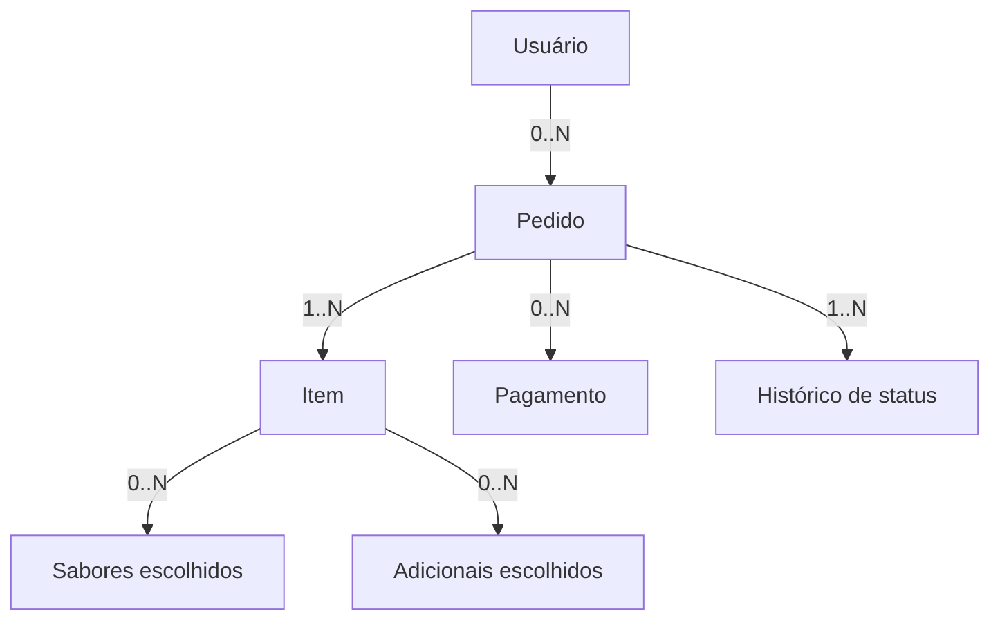

# Pizzaria Campy — Estrutura do banco de dados

Versão 2 — Catálogo configurável e cadastro simplificado no Admin · 16/10/2026

## 1. Escopo e evidências

Esta proposta organiza as entidades necessárias ao catálogo, clientes, pedidos, pagamentos PIX, cupons, entrega e administração da Pizzaria Campy. Os nomes de tabelas e campos abaixo são sugestões para discussão e documentação. Não representam uma extração do banco atual.

A versão 2 incorpora o objetivo de oferecer Pizza Grande com 1 ou 2 sabores, Broto e as demais categorias em um fluxo de compra semelhante ao de aplicativos de delivery. Especifica também o cadastro simplificado no Admin. Trata-se de uma especificação para o aplicativo Flutter/FastAPI existente; as telas e migrations ainda não foram implementadas.

Decisão central: o administrador cadastra o sabor uma única vez e informa seus preços por tamanho. As opções “Grande — 1 sabor” e “Grande — 2 sabores” são configurações do mesmo produto/tamanho, geradas para o cliente sem duplicar sabores ou preços.

Fontes consultadas:

- `Markdown colado(1).md`, auditoria da área Admin de 16/10/2026. Documenta Flutter, FastAPI, catálogo com tamanhos e sabores, preços, bordas, adicionais, revisão de PIX, cupons, zonas de entrega, horários e configurações.
- `cardapio_pizzaria_campy(1).xlsx`, aba `Cardapio`. Possui 269 linhas de dados, seis categorias e seis linhas sem preço. Uma linha representa uma oferta/tamanho, e não necessariamente um produto diferente.

Os models, enums, migrations e o SGBD não foram disponibilizados nesta solicitação. A implementação física deverá ser conciliada com esses arquivos, preservando contratos da API e dados existentes.

## 2. Visão geral

| Área | Tabelas propostas |
| --- | --- |
| Pessoas | `users`, `customer_addresses` |
| Catálogo | `categories`, `products`, `product_sizes`, `pizza_configurations`, `flavors`, `product_flavors`, `flavor_prices` |
| Personalização | `crusts`, `crust_prices`, `addons`, `addon_prices` |
| Combos | `combo_groups`, `combo_group_options` |
| Vendas | `orders`, `order_items`, `order_item_flavors`, `order_item_addons`, `order_status_history` |
| Pagamentos e descontos | `payments`, `coupons` |
| Operação | `delivery_zones`, `business_hours`, `store_settings` |

São 25 tabelas no modelo proposto. A separação física deve aproveitar as entidades equivalentes já existentes. A nova entidade lógica `pizza_configurations` separa tamanho físico de quantidade de sabores.

## 3. Convenções

- `id`: chave primária. Manter o tipo de identificador adotado pelo projeto, sem converter UUID para inteiro ou o contrário.
- `*_id`: referência a outra entidade, conforme as relações descritas abaixo.
- `?`: campo opcional/nulo. Os demais campos são obrigatórios nesta proposta.
- Valores monetários: `NUMERIC(12,2)` e aritmética decimal no servidor. Preservar o arredondamento já implementado.
- Quantidades: inteiros positivos para os produtos do cardápio atual.
- Eventos: instante com timezone, persistido em UTC. Horários semanais usam hora local e o fuso da loja.
- Cadastros mutáveis: `created_at`, `updated_at` e `active`, quando aplicável.
- Nomes e textos: texto com limites coerentes nos schemas de entrada. Telefone, CEP e código do cardápio são texto.
- Preferir inativação de cadastros referenciados por vendas. A política de retenção de dados pessoais deve ser tratada separadamente.

## 4. Pessoas

### `users`

| Campo | Tipo ou referência | Finalidade |
| --- | --- | --- |
| `id` | PK | Identificador |
| `name` | Texto | Nome do usuário |
| `email` | Texto normalizado | Login, se adotado na autenticação atual |
| `phone?` | Texto | Contato |
| `password_hash` | Texto | Hash da senha, nunca senha em texto |
| `role` | Enum existente | Preservar os papéis atuais, incluindo `ADMIN` e `MANAGER` |
| `active` | Booleano | Disponibilidade da conta |
| `created_at`, `updated_at` | Instante | Auditoria do cadastro |

O identificador de login e suas restrições de unicidade devem seguir a autenticação existente. Não cadastrar um administrador em uma tabela paralela de clientes.

### `customer_addresses`

Campos: `id` PK, `user_id` FK → `users`, `label?`, `postal_code?`, `street`, `number`, `complement?`, `neighborhood`, `city`, `state`, `reference?`, `is_default`, `active`, `created_at`, `updated_at`.

Um usuário possui zero ou vários endereços. Se houver endereço padrão, garantir no máximo um endereço ativo padrão por usuário. A API deve verificar a propriedade do endereço ao criar o pedido.

## 5. Catálogo e preços

| Tabela | Campos principais | Restrições e significado |
| --- | --- | --- |
| `categories` | `id` PK, `name`, `display_order`, `active` | Agrupamento comercial |
| `products` | `id` PK, `category_id` FK, `menu_code?`, `name`, `description?`, `image_url?`, `kind`, `pricing_mode`, `active` | `kind` e `pricing_mode` são conceitos propostos; mapear aos tipos atuais |
| `product_sizes` | `id` PK, `product_id` FK, `label`, `fixed_price?`, `flavor_pricing_rule?`, `active` | Variação vendável: Grande, Broto, Unidade, 1L, 2L etc. Para pizza, define a regra de cobrança vigente |
| `pizza_configurations` | `id` PK, `product_size_id` FK, `flavor_count`, `display_name`, `display_order`, `active` | Quantidade exata de sabores de uma opção: Grande 1 sabor, Grande 2 sabores, Broto 1 sabor |
| `flavors` | `id` PK, `name`, `description?`, `active` | Recheios disponíveis para composição |
| `product_flavors` | `product_id` FK, `flavor_id` FK | PK composta; informa quais sabores um produto permite |
| `flavor_prices` | `product_id` FK, `product_size_id` FK, `flavor_id` FK, `price`, `active` | Preço do sabor para uma variação específica |

Proposta de comportamento:

- Produto simples, como bebida ou esfiha individual: valor em `product_sizes.fixed_price`.
- Pizza configurável: produto representa o tipo de pizza e seus tamanhos; `flavors` representa os recheios, com valores em `flavor_prices`.
- Combo: variação tem seu preço total em `fixed_price`, com composição nas tabelas da seção 7.
- Para cada produto, escolher uma fonte de preço. Não somar preço fixo da pizza e preço integral do sabor sem uma regra explícita.
- Nomes de modos, como `FIXED` e `BY_FLAVOR`, seriam novos contratos. Só devem ser utilizados após conciliação com os enums atuais.

Integridade dos preços:

1. `UNIQUE(product_id, label)` em `product_sizes`.
2. `UNIQUE(product_size_id, flavor_id)` em `flavor_prices`.
3. A variação e o sabor de `flavor_prices` devem pertencer ao mesmo produto. No modelo físico, usar FKs compostas para `(product_id, product_size_id)` e `(product_id, flavor_id)`, com as chaves únicas correspondentes.
4. Preços cadastrados devem ser não negativos. Preço desconhecido permanece nulo/ausente e bloqueia a venda daquela oferta até definição.
5. `UNIQUE(product_size_id, flavor_count)` em `pizza_configurations`; `flavor_count` é inteiro positivo. A configuração pertence a um tamanho de produto pizza.
6. Quantidade permitida é definida pelas configurações ativas. Um eventual `max_flavors` legado deve ser derivado ou mantido compatível, sem virar uma segunda fonte independente de regra.

### Exemplo de normalização

As linhas “A Moda do Chefe I / Grande / R$ 50,00” e “A Moda do Chefe I / Broto / R$ 33,00” podem representar um único sabor com dois preços. Não exigem duplicar o sabor.

Se o sistema atual já representa cada pizza como produto, manter essa identidade e mapear as variações existentes. Esta proposta não exige alterar IDs nem reconstruir o catálogo.

## 6. Bordas e adicionais

| Tabela | Campos principais | Regra |
| --- | --- | --- |
| `crusts` | `id` PK, `name`, `description?`, `active` | Cadastro de bordas |
| `crust_prices` | `product_size_id` FK, `crust_id` FK, `price`, `active` | PK composta; define compatibilidade e valor por variação |
| `addons` | `id` PK, `name`, `description?`, `active` | Extras selecionáveis |
| `addon_prices` | `product_size_id` FK, `addon_id` FK, `unit_price`, `max_quantity?`, `active` | PK composta; define compatibilidade e valor por variação |

Não transformar “azeitona, molho de tomate e orégano” em adicionais pagos: o cardápio os descreve como acompanhamentos incluídos. Podem permanecer na descrição enquanto não houver seleção estruturada.

As células “Não informado” de borda indicam ausência de informação. Não comprovam existência, gratuidade ou indisponibilidade de uma borda.

## 7. Combos

O cardápio contém quatro combos de esfihas com refrigerante. Como não informa a divisão exata das esfihas entre os sabores permitidos, a proposta usa grupos de escolha.

| Tabela | Campos principais | Regra |
| --- | --- | --- |
| `combo_groups` | `id` PK, `combo_size_id` FK → `product_sizes`, `label`, `required_quantity`, `selection_mode`, `display_order` | Ex.: escolher 20 esfihas; incluir 1 refrigerante. Modo de escolha ou composição fixa |
| `combo_group_options` | `group_id` FK, `component_size_id` FK → `product_sizes`, `fixed_quantity?`, `active` | PK composta; opções permitidas no grupo. No modo fixo, registrar a quantidade de cada componente |

Para o Combo 1, por exemplo, haveria um grupo com 20 unidades entre as esfihas permitidas e outro com 1 Dolly de 2L. A distribuição pode ser escolhida pelo cliente ou fixada pela loja após confirmação da regra.

O servidor valida a soma de quantidades de cada grupo. Nesta proposta, componentes são produtos simples e não podem referenciar o próprio combo nem formar combos recursivos. Acréscimos por troca de componente exigiriam regra adicional, ainda não definida.

No modo fixo, a soma de `fixed_quantity` dos componentes deve ser igual a `required_quantity`; o cliente apenas confere a composição. No modo de escolha, o pedido registra a distribuição feita pelo cliente entre as opções válidas.

Essas tabelas são uma proposta para a composição estruturada. A auditoria não confirma que esse recurso já exista na API.

## 8. Pedidos

### `orders`

| Campo | Tipo ou referência | Finalidade |
| --- | --- | --- |
| `id` | PK | Identificador interno |
| `number` | Texto ou número único | Número exibido ao cliente |
| `customer_id` | FK → `users` | Cliente responsável; checkout sem conta depende de regra específica |
| `status` | Enum atual | Estado operacional |
| `fulfillment_type` | Enum atual | Entrega ou retirada |
| `customer_name_snapshot`, `customer_phone_snapshot?` | Texto | Contato utilizado na compra |
| `source_address_id?` | FK → `customer_addresses` | Endereço de origem, quando aplicável |
| `delivery_address_snapshot?` | Estrutura de endereço | Cópia do endereço usado; obrigatória para entrega |
| `delivery_zone_id?` | FK → `delivery_zones` | Zona aplicada |
| `coupon_id?` | FK → `coupons` | Cupom utilizado |
| `coupon_code_snapshot?` | Texto | Código aplicado na compra |
| `subtotal`, `discount_total`, `delivery_fee`, `total` | Monetário | Totais calculados pelo servidor |
| `notes?` | Texto | Observações |
| `idempotency_key` | Texto único | Evitar duplicar o pedido em uma repetição da mesma requisição |
| `created_at`, `updated_at` | Instante | Datas do pedido |

O snapshot de endereço pode usar colunas próprias, uma tabela 1:1 ou JSON validado, conforme o SGBD e o padrão atual. A referência ao cadastro não substitui essa cópia histórica.

### `order_items`

Campos: `id` PK, `order_id` FK → `orders`, `product_size_id` FK → `product_sizes`, `pizza_configuration_id?` FK → `pizza_configurations`, `configuration_name_snapshot?`, `flavor_count_snapshot?`, `pricing_rule_snapshot?`, `parent_item_id?` FK → `order_items`, `combo_group_id?` FK → `combo_groups`, `product_name_snapshot`, `size_label_snapshot`, `quantity`, `base_unit_price`, `crust_id?` FK → `crusts`, `crust_name_snapshot?`, `crust_unit_price`, `unit_price`, `line_total`, `notes?`, `included_in_parent`.

- Item comum ou combo principal: `included_in_parent = false` e sem pai.
- Componente de combo: `included_in_parent = true`, vinculado ao item principal e ao grupo correspondente. Não é cobrado novamente.
- Pai e filho devem pertencer ao mesmo pedido. Permitir apenas um nível de componentes.
- Quantidades dos componentes são totais da linha: para dois combos de 20 esfihas, os filhos registram 40 esfihas no total.
- Para filhos incluídos, valores cobrados são zero. Eventuais preços de referência não entram no subtotal.
- Para itens cobrados: `unit_price = base_unit_price + crust_unit_price + adicionais_por_unidade` e `line_total = quantity × unit_price`, conforme o arredondamento oficial.

### Personalizações e histórico

| Tabela | Campos principais | Regra |
| --- | --- | --- |
| `order_item_flavors` | `id` PK, `order_item_id` FK, `flavor_id` FK, `flavor_name_snapshot`, `fraction_numerator`, `fraction_denominator`, `reference_price_snapshot` | Registra cada sabor e sua fração. Não somar preços de referência diretamente ao total |
| `order_item_addons` | `id` PK, `order_item_id` FK, `addon_id` FK, `addon_name_snapshot`, `quantity_per_unit`, `unit_price_snapshot` | Quantidade do extra por unidade do item principal |
| `order_status_history` | `id` PK, `order_id` FK, `from_status?`, `to_status`, `changed_by_id?` FK → `users`, `reason?`, `created_at` | Histórico de transições, incluindo criação e cancelamento |

Para uma pizza meio a meio: duas linhas de sabor com fração `1/2`. Numeradores e denominadores são inteiros positivos e a soma das frações deve ser exatamente 1. O servidor valida sabores, limite, tamanho e preços na mesma transação.

Na versão 2, a configuração determina a quantidade exata de sabores distintos: 1 sabor usa uma fração `1/1`; 2 sabores usam duas frações `1/2`. A configuração deve pertencer ao tamanho escolhido e ao produto do item. No modelo físico, usar FK composta correspondente ou validação transacional equivalente. Selecionar o mesmo sabor duas vezes não atende à opção “2 sabores”.

A regra de cobrança de múltiplos sabores deve vir do backend atual. O cardápio não define se a cobrança usa maior preço, média ou outro critério.

Valores e descrições de pedidos concluídos ficam preservados. Atualizar o catálogo ou o endereço cadastrado não recalcula pedidos anteriores.

## 9. Pagamentos e cupons

### `payments`

Campos: `id` PK, `order_id` FK → `orders`, `method` enum atual, `status` enum atual, `amount`, `provider?`, `provider_reference?`, `proof_url?`, `reviewed_by_id?` FK → `users`, `reviewed_at?`, `review_note?`, `idempotency_key`, `created_at`, `updated_at`.

- A auditoria confirma revisão de pagamentos PIX. Os demais meios e todos os status precisam ser conferidos nos enums atuais.
- O modelo admite zero ou várias tentativas/registros por pedido. Isso não autoriza múltiplas confirmações nem pagamento fracionado.
- Para o fluxo de pagamento único, impedir confirmações duplicadas por controle transacional e pela restrição apropriada ao SGBD, após analisar os dados existentes.
- `idempotency_key` deve ser único. Se existir provedor, sua referência também deve ser única dentro do escopo do provedor.
- Comprovante enviado não significa pagamento confirmado. Restringir acesso ao comprovante e mantê-lo fora de métricas e logs.
- Cancelar um pedido não comprova devolução do dinheiro. Política e registro de estorno precisam de definição própria; não criar status fictícios para representar isso.

### `coupons`

Campos: `id` PK, `code` único e normalizado, `discount_type`, `discount_value`, `min_order_value?`, `max_discount?`, `starts_at?`, `ends_at?`, `max_uses?`, `max_uses_per_customer?`, `active`, `created_at`, `updated_at`.

Campos e limites devem ser mapeados ao contrato atual. Nesta proposta, um pedido recebe no máximo um cupom. Registrar o desconto aplicado no pedido e validar uso/limites com proteção contra concorrência. A regra de quando o uso é consumido ou devolvido em cancelamentos precisa ser definida antes de implementar contadores.

## 10. Operação da loja

| Tabela | Campos principais | Regras |
| --- | --- | --- |
| `delivery_zones` | `id` PK, `name`, `coverage_definition`, `delivery_fee`, `min_order_value?`, `estimated_minutes?`, `active` | Manter a representação de cobertura atual: bairro, CEP ou geometria, sem substituir por suposição |
| `business_hours` | `id` PK, `weekday`, `opens_at`, `closes_at`, `closes_next_day`, `active` | Zero ou vários intervalos por dia; `closes_next_day` permite funcionamento após meia-noite |
| `store_settings` | `id` PK, `name`, `phone?`, `address?`, `timezone`, `accepting_orders`, `updated_at` | Configuração de uma única loja nesta proposta |

Horários usam convenção explícita para dia da semana, por exemplo 0 = segunda e 6 = domingo. Validar intervalos sobrepostos e a passagem de dia no servidor. Os nomes e a estrutura física devem preservar os contratos existentes.

Taxa e endereço aplicados ficam copiados no pedido. Se a cobertura ou a taxa mudar, pedidos anteriores mantêm seus dados.

## 11. Relacionamentos e cardinalidades

| Origem | Destino | Cardinalidade |
| --- | --- | --- |
| Usuário | Endereço cadastrado | 1 → 0..N |
| Usuário cliente | Pedido | 1 → 0..N; cada pedido tem 1 cliente nesta proposta |
| Categoria | Produto | 1 → 0..N |
| Produto | Variação/tamanho | 1 → 0..N; produto à venda exige ao menos 1 variação vendável |
| Variação/tamanho de pizza | Configuração de sabores | 1 → 0..N; pizza disponível exige ao menos 1 configuração ativa |
| Produto | Sabor | N ↔ N via `product_flavors` |
| Variação/tamanho | Sabor com preço | N ↔ N via `flavor_prices`, restrito aos sabores do produto |
| Variação/tamanho | Borda | N ↔ N via `crust_prices` |
| Variação/tamanho | Adicional | N ↔ N via `addon_prices` |
| Variação de combo | Grupo de componentes | 1 → 0..N; combo estruturado exige ao menos 1 grupo |
| Grupo de combo | Variação componente | N ↔ N via `combo_group_options` |
| Pedido persistido | Item | 1 → 1..N |
| Item de combo | Componente no pedido | 1 → 0..N |
| Item | Sabor escolhido | 1 → 0..N; pizza configurável exige ao menos 1 |
| Item | Adicional escolhido | 1 → 0..N |
| Item | Borda escolhida | N → 0..1 |
| Item de pizza | Configuração escolhida | N → 1; produtos simples não têm configuração de pizza |
| Pedido | Registro/tentativa de pagamento | 1 → 0..N |
| Pedido | Histórico de status | 1 → 1..N após criação |
| Cupom | Pedido | 1 → 0..N; cada pedido usa 0..1 cupom |
| Zona de entrega | Pedido | 1 → 0..N; cada pedido usa 0..1 zona |

Obrigatoriedades envolvendo a contagem de filhos, somas e transições exigem validação transacional no servidor ou mecanismo específico do SGBD. Uma FK isolada não garante essas regras.

### Relações centrais de venda

O diagrama mostra os filhos de cada registro. Os detalhes de catálogo e as associações opcionais estão na tabela de cardinalidades.

## 12. Regras operacionais preservadas

A auditoria descreve os seguintes fluxos:

- Entrega: `PENDING → CONFIRMED → PREPARING → READY → OUT_FOR_DELIVERY → DELIVERED`.
- Retirada: `PENDING → CONFIRMED → PREPARING → READY → DELIVERED`.

Cancelamentos e outras transições devem seguir `ORDER_TRANSITIONS` do backend. Não inferir de quais estados se pode cancelar. Pedido e pagamento possuem estados independentes.

No fechamento do pedido, o servidor deve:

1. Validar sessão, cliente e propriedade do endereço.
2. Conferir loja aberta, cobertura e disponibilidade das seleções.
3. Recalcular preços usando o catálogo e a regra vigente para sabores.
4. Validar e aplicar o cupom, preservando o desconto calculado.
5. Calcular `subtotal` apenas com linhas cobradas e `total = subtotal - discount_total + delivery_fee`, sem total negativo.
6. Persistir pedido, itens, personalizações, snapshots e histórico em uma única transação.
7. Tratar repetição de requisição com idempotência.

Transições posteriores devem proteger contra atualizações concorrentes e gravar o novo status e seu histórico atomicamente.

## 13. Mapeamento do cardápio

| Coluna da planilha | Destino lógico | Tratamento |
| --- | --- | --- |
| `categoria` | `categories.name` | Preservar as seis categorias observadas |
| `produto` | Produto ou sabor, conforme tipo | Separar código e nome somente quando a origem for inequívoca |
| `descrição` | `products.description` ou `flavors.description` | Preservar composição e observações |
| `tamanho` | `product_sizes.label` | Textos de composição de combo devem ser tratados como composição |
| `preço` | `fixed_price` ou `flavor_prices.price` | Seis linhas sem valor exigem revisão; não importar como zero |
| `sabores` | Sabores permitidos ou composição de combo | Não gerar sabores de pizza para bebidas automaticamente |
| `borda` | Pendência de cadastro | “Não informado” e “Não se aplica” não criam bordas |
| `adicionais` | Descrição de inclusões ou componentes | Distinguir acompanhamento incluído de extra pago |

Categorias observadas na planilha: Pizzas salgadas, Pizzas doces, Bebidas, Esfihas salgadas, Esfihas doces e Combos de esfihas. A solicitação da versão 2 também inclui “Doces”, como categoria separada para sobremesas que não sejam pizzas ou esfihas. Não preencher essa categoria com produtos inventados.

As ofertas “A Moda do Freguês” e “Três Estações” têm regras de composição descritas e preço ausente. “Personalizada” não define o tamanho físico da pizza. Essas ofertas precisam de tamanho, preço e regra de seleção antes da venda automatizada.

Para “A Moda do Freguês”, selecionar quatro ingredientes exige uma modelagem de ingredientes/opções caso isso não exista no backend. Não confundir ingrediente com sabor. A descrição pode ser mantida até essa regra ser formalizada.

## 14. Índices e integridade

Índices candidatos, a confirmar com as consultas reais:

- `orders(customer_id, created_at)` para histórico do cliente.
- `orders(status, created_at)` para operação Admin.
- `payments(order_id)` e índice adequado à fila de revisão.
- `order_items(order_id)`, `order_status_history(order_id, created_at)`.
- Índices nas FKs de tabelas associativas e nas buscas de categoria/produto.
- Unicidade de número do pedido, login, código do cupom, idempotência e pares das tabelas de associação.
- `UNIQUE(order_item_id, flavor_id)` e `UNIQUE(order_item_id, addon_id)` para consolidar seleções repetidas na mesma linha.

Utilizar FKs para impedir referências inválidas. Referências de vendas devem restringir exclusões de cadastros necessários ao histórico; inativar esses cadastros. Exclusão em cascata de pedidos não deve ser adotada como rotina operacional.

Não há justificativa para criar uma tabela de dashboard: métricas são consultas sobre pedidos e pagamentos, com filtros e intervalos consistentes. Vendas operacionais e dinheiro recebido devem ser calculados e exibidos como métricas distintas.

## 15. Conciliação com a implementação existente

Para transformar este modelo em documentação exata ou SQL executável:

1. Inspecionar os models do backend, migrations, schemas e enums.
2. Identificar o SGBD, a revisão atual e as restrições já existentes.
3. Mapear cada entidade desta proposta às tabelas reais, mantendo nomes e IDs existentes.
4. Conferir regras de sabores, preços, adicionais, cupons, entrega e pagamentos nos serviços atuais.
5. Identificar lacunas reais antes de propor novas colunas ou tabelas.
6. Produzir migration incremental apenas para alterações necessárias, validando dados anteriores e rollback conforme o projeto.

Autenticação com refresh e notificações Firebase/WebSocket já aparecem na auditoria. Tabelas de sessão, dispositivos ou eventos devem ser documentadas a partir do código atual; não é necessário inventar persistência adicional para explicar essas integrações.

Este documento entrega a estrutura lógica e a especificação de experiência para implementação. Não foi executada alteração no banco, nem criada migration.

## 16. Cardápio apresentado ao cliente

### Categorias

| Categoria | Tipo de cadastro | Comportamento no aplicativo |
| --- | --- | --- |
| Pizzas salgadas | Pizza configurável | Escolher tamanho/quantidade de sabores, sabores, borda e extras disponíveis |
| Pizzas doces | Pizza configurável | Mesmo fluxo, mostrando somente os sabores vinculados às pizzas doces |
| Doces | Produto simples | Sobremesas por unidade/porção e complementos existentes |
| Bebidas | Produto simples | Marca/produto, volume ou apresentação, quantidade |
| Esfihas salgadas | Produto simples | Cada sabor é um produto com preço por unidade |
| Esfihas doces | Produto simples | Cada sabor é um produto com preço por unidade |
| Combos de esfihas | Combo | Escolher as quantidades de cada sabor permitido e o refrigerante incluído |

Categoria é uma seção comercial; tipo determina o formulário e o fluxo de compra. Não identificar o tipo comparando textos do nome da categoria. Uma categoria sem nenhuma oferta disponível pode ficar visível no Admin e oculta no cardápio do cliente.

### Ofertas de pizza

| Opção exibida | Tamanho cadastrado | Sabores exatos | Disponibilidade inicial proposta |
| --- | --- | --- | --- |
| Pizza Grande — 1 sabor | Grande | 1 | Habilitar quando houver preço e sabor disponíveis |
| Pizza Grande — 2 sabores | Grande | 2 diferentes, metade de cada | Habilitar quando houver ao menos 2 sabores elegíveis e regra de preço definida |
| Pizza Broto — 1 sabor | Broto | 1 | Habilitar quando houver preço e sabor disponíveis |
| Pizza Broto — 2 sabores | Broto | 2 diferentes, metade de cada | Opcional, inicialmente desativada até a loja definir se oferece |

Aplicar as configurações a pizzas salgadas e doces de forma independente. Não ativar automaticamente duas metades em pizzas doces ou em Broto por existir essa opção nas salgadas Grandes.

### Sequência da compra

1. Cliente abre a categoria de pizza.
2. Escolhe uma oferta, como “Grande — 2 sabores”. A tela já sabe o tamanho e a quantidade de sabores; não pede a mesma informação novamente.
3. Seleciona dois sabores distintos da lista válida para aquele produto e tamanho. A tela mostra “Escolha 2 sabores · 1 de 2 selecionado”.
4. Escolhe uma borda, se houver bordas disponíveis. “Sem borda recheada” é opção válida sem acréscimo, não uma borda cujo preço foi esquecido.
5. Escolhe adicionais opcionais e informa observação.
6. Confere o preço calculado e adiciona ao carrinho.

Para uma oferta de 1 sabor, usar seleção única. Para 2 sabores, usar seleção múltipla limitada a 2; ao atingir o limite, mostrar como remover/trocar uma escolha. O botão de adicionar fica indisponível até a seleção obrigatória estar completa, com indicação do que falta.

Mostrar “1 pizza, metade de cada sabor”, evitando interpretar “2 sabores” como duas pizzas. Ao editar no carrinho, restaurar as escolhas e recalcular pelo servidor. Quantidade 2 multiplica a mesma composição; para composições diferentes, usar linhas separadas.

Exemplo de resumo para cliente e cozinha: “1 × Pizza Grande — 2 sabores · 1/2 sabor A + 1/2 sabor B · sem borda recheada”. Observações e extras selecionados aparecem junto do item, preservando a composição completa.

### Preço antes e depois da seleção

- Antes de escolher: “A partir de R$ ...”, calculado com as combinações realmente disponíveis para aquela configuração e regra.
- Depois de escolher: preço exato da pizza e seus acréscimos, com a regra de cobrança informada em linguagem simples.
- Não anunciar um mínimo que não possa ser comprado: na opção de 2 sabores distintos, calcular o mínimo entre pares elegíveis, não copiar automaticamente o menor sabor individual.
- Taxa de entrega pertence ao pedido e não ao preço unitário da pizza.
- Ao fechar, o backend confirma disponibilidade e preço. Se houver alteração, informar e pedir a revisão do carrinho antes de concluir, sem trocar valores silenciosamente.

## 17. Regra de cobrança dos sabores

O comportamento visual solicitado não determina a regra comercial. Não presumir que exista uma única regra universal de preço do iFood.

| Regra configurável | Exemplo ilustrativo: sabores de R$ 50 e R$ 60 | Texto ao cliente |
| --- | --- | --- |
| Maior valor | Pizza de 2 sabores = R$ 60 | “Nas pizzas de 2 sabores, vale o preço do sabor de maior valor.” |
| Média proporcional | Metade de R$ 50 + metade de R$ 60 = R$ 55 | “O valor considera a metade de cada sabor escolhido.” |

Valores são apenas um exemplo de cálculo. A regra atualmente implementada deve ser preservada. Na configuração inicial da loja, o Admin deve exibir a regra atual ou exigir a definição quando não houver regra existente; não aplicar uma alteração silenciosa. A proposta comporta as duas regras sem cadastrar todas as combinações possíveis de sabores.

Para pizza de 1 sabor, cobrar o preço integral do sabor no tamanho escolhido. Para 2 sabores, aplicar a regra da variação/tamanho. Bordas e extras somam uma única vez por unidade da pizza, a menos que o backend já tenha outra regra explícita, que precisa ser conciliada.

O formulário de sabor solicita o preço da pizza inteira por tamanho. Não solicitar que o operador calcule o preço de cada metade. O cálculo ocorre no servidor com valores decimais.

## 18. Admin: uma área de Cardápio

Reunir categorias, produtos, tamanhos, sabores, preços, bordas e adicionais em “Cardápio”. Esses recursos podem ter componentes internos diferentes, mas o operador não precisa abrir várias telas para concluir um cadastro.

### Organização geral

| Entrada do Admin | Conteúdo |
| --- | --- |
| Visão geral | Resumo de operação e atalhos para pedidos e pendências |
| Pedidos | Busca, filtros, detalhes, próximos passos permitidos e revisão de PIX vinculada ao pedido |
| Cardápio | Categorias e cadastros dos três tipos, com preços e disponibilidade no mesmo contexto |
| Clientes | Busca, paginação e detalhes já autorizados pela API |
| Cupons | Criação, edição, regras e ativação, preservando o contrato atual |
| Loja | Horários, zonas/taxas de entrega e dados da pizzaria |

Preservar autenticação, controle de acesso, dashboard, cancelamentos, revisão de PIX, notificações e demais funcionalidades existentes. Melhorias de navegação não mudam permissões nem transições oficiais de pedidos.

### Tela principal do Cardápio

- Categorias em abas ou lista adaptada ao espaço disponível, com ordenação e estado ativo/pausado.
- Busca de itens por nome/código e filtro de disponibilidade.
- Botão contextual: “Adicionar sabor”, “Adicionar produto” ou “Criar combo”.
- Preço, disponibilidade, editar, duplicar e pausar acessíveis sem menus técnicos extensos.
- Ação de configurar tamanhos e quantidade de sabores dentro da categoria de pizza.
- Status claros: “Disponível”, “Pausado” ou pendência específica como “Falta preço do Broto”. Estados de pendência são derivados; não são novos status de pedido.
- Uma prévia “Como o cliente verá” usa as regras e os dados do catálogo, sem manter outra cópia do cadastro.

### Configuração inicial das pizzas

Feita uma vez por produto/tipo de pizza e editável posteriormente:

1. Selecionar os tamanhos oferecidos, inicialmente Grande e Broto conforme o catálogo.
2. Marcar as quantidades de sabores por tamanho: Grande com 1 e 2; Broto com 1, permitindo ativar 2 se a loja oferecer.
3. Conferir a regra de cobrança em cada tamanho.
4. Informar bordas e adicionais disponíveis, com preços por tamanho, quando existirem.
5. Visualizar as ofertas que serão geradas para o cliente.

O operador não cadastra manualmente um produto “Grande 2 sabores” para cada combinação. As opções são geradas de `pizza_configurations` e dos sabores elegíveis.

## 19. Cadastro simples por tipo

### A. Adicionar sabor de pizza

Um único formulário:

| Campo visível | Comportamento |
| --- | --- |
| Tipo/categoria | Salgada ou doce; preenchida pelo contexto da tela |
| Nome do sabor | Obrigatório |
| Ingredientes/descrição | Texto que aparecerá ao cliente |
| Foto | Opcional conforme o padrão atual |
| Grande | Disponibilidade para esse tamanho e preço da pizza inteira |
| Broto | Disponibilidade para esse tamanho e preço da pizza inteira |
| Disponível para venda | Ativa apenas as ofertas completas e válidas |

Ao salvar, o backend vincula sabor, produto e preços aos tamanhos marcados. O usuário do Admin não manipula `product_id`, `size_id`, tabelas de associação ou frações.

O mesmo preço Grande atende às opções Grande 1 sabor e Grande 2 sabores. O operador não precisa repeti-lo. Para um sabor vendido apenas em Grande, desmarcar Broto; isso não impede a venda em Grande.

Na edição em lote, oferecer uma matriz:

| Sabor | Grande | Broto | Disponibilidade |
| --- | --- | --- | --- |
| Nome do sabor | Campo de preço | Campo de preço ou não oferecido | Ativo/pausado |

Valores em branco significam pendência ou tamanho não oferecido, conforme o controle de disponibilidade. Não converter campos vazios em preço zero nem obrigar todo sabor a ter todos os tamanhos.

### B. Adicionar produto simples

Usar para Doces, Bebidas, Esfihas salgadas e Esfihas doces:

- Categoria, nome, descrição e foto.
- Preço e apresentação: unidade, porção, lata ou volume.
- Se o mesmo produto tiver apresentações diferentes, permitir “Adicionar variação” no próprio formulário.
- Disponibilidade e complementos apenas quando aplicáveis.

Não mostrar “quantidade de sabores”, preço de meia pizza, massa ou borda nesse formulário. Esfiha individual de carne e esfiha individual de queijo são produtos próprios; não usar o cadastro de recheios de pizza para elas.

### C. Criar combo de esfihas

1. Informar nome, descrição, foto e preço total do combo.
2. Definir “Quantidade de esfihas”: 20, 30 ou 40, conforme o combo real.
3. Selecionar os produtos de esfiha permitidos, reutilizando o catálogo existente.
4. Selecionar a bebida incluída e sua quantidade. Se houver uma única bebida, mostrá-la ao cliente como incluída, sem exigir uma escolha desnecessária.
5. Conferir a prévia e salvar.

Cliente distribui as esfihas entre os sabores permitidos com controles de quantidade. Mostrar “12 de 20 esfihas escolhidas” e impedir conclusão com 19 ou 21. Quantidades são livres dentro do total, sem inventar obrigação de escolher todos os sabores. Se a composição real for fixa, o Admin deve cadastrá-la como fixa em vez de simular uma escolha.

Os componentes não são cobrados uma segunda vez. A bebida incluída e seus vínculos precisam estar definidos mesmo quando a bebida avulsa não tem preço conhecido. Para isso, a elegibilidade como componente incluído deve ser validada separadamente da venda avulsa; preço avulso ausente não vira gratuito.

### Salvar com segurança e clareza

- Uma ação principal “Salvar”; preservar os dados digitados em caso de falha.
- Validar junto do campo e explicar o que corrigir, sem exibir stack trace ou IDs técnicos.
- Salvar o conjunto de alterações do formulário de forma atômica, evitando sabor sem preço por falha na segunda chamada.
- Permitir guardar cadastro incompleto sem disponibilizá-lo, conforme suporte ou extensão necessária no backend.
- Ao pausar um sabor ou tamanho, refletir a alteração em todas as ofertas dependentes. Reativar só torna compráveis as ofertas completas.
- “Duplicar” cria um novo cadastro a partir dos dados atuais e pede nome, preços e confirmação de disponibilidade; não publica uma cópia silenciosamente.
- Usar valores de moeda com entrada em pt-BR e conversão validada no servidor.
- Celular: campos empilhados; desktop/tablet: preços Grande e Broto lado a lado, quando couberem.

## 20. Disponibilidade e validação conjunta

Uma configuração de pizza fica comprável apenas quando categoria, produto, tamanho e configuração estão ativos; sua regra de preço existe; e há pelo menos a quantidade necessária de sabores ativos, vinculados ao produto e com preço válido para aquele tamanho.

Um sabor pode ser pausado globalmente ou apenas em um tamanho pelo vínculo de preço. Em ambos os casos, o backend calcula a disponibilidade efetiva e o cliente recebe a lista elegível, evitando duplicar regras divergentes no Flutter.

Pedido de Grande 2 sabores deve ser recusado quando:

- Contém apenas um sabor ou mais de dois.
- Repete o mesmo sabor em duas posições.
- Usa sabor sem preço Grande, pausado ou de outro produto/tipo de pizza.
- Envia Broto com uma configuração de Grande.
- Informa frações diferentes de duas metades na configuração de 2 sabores.
- Usa borda/adicional incompatível com o tamanho.
- Envia um preço adulterado em relação ao cálculo oficial.

Produto simples não recebe configuração de pizza nem registros em `order_item_flavors`. Combos devem validar catálogo, opções de cada grupo e soma de quantidades no backend, além da interface.

## 21. Contratos e implementação no projeto existente

Implementar incrementalmente em Flutter e FastAPI. Os nomes abaixo descrevem responsabilidades; não pressupõem novas URLs nem renomeação dos arquivos atuais.

| Camada | Responsabilidade necessária |
| --- | --- |
| Banco/models | Mapear tipos atuais; acrescentar configurações somente se a entidade equivalente não existir; relacionar escolhas ao pedido |
| Catálogo da API | Retornar categorias, ofertas, configurações, preços por tamanho e disponibilidade efetiva sem consultas em sequência para cada sabor |
| Cálculo da API | Serviço único para preço, sabores, bordas e adicionais, usado pelo carrinho/fechamento e pela prévia do Admin |
| Cadastro Admin da API | Caso de uso transacional para salvar o sabor com seus vínculos e preços; manter contratos antigos durante a transição |
| Admin Flutter | Formulários por tipo, preço em matriz, contexto preservado, validações e mensagens compartilhadas |
| Cliente Flutter | Ofertas por tamanho/quantidade de sabores, escolha guiada, preço exato, edição do carrinho |
| Pedidos | Snapshot de configuração, sabores, frações, regra e valores; resumo legível para cozinha e cliente |

A API pode entregar as opções no formato lógico `produto → tamanhos → configurações + sabores/preços`. O Flutter não deve inferir “2 sabores” a partir do texto do título. IDs e `flavor_count` são a referência de validação.

Manter os endpoints atuais até os dois aplicativos/áreas consumidores estarem migrados. Para carrinhos antigos, reconciliar as escolhas com a configuração equivalente e recalcular; quando não houver correspondência, solicitar revisão do item. Não apagar carrinhos nem converter silenciosamente dois sabores em um.

### Ordem de execução

1. Inspecionar repositório, models, migrations, serviços de preço e telas atuais.
2. Mapear o cardápio existente e revisar as seis linhas sem preço. Separar “Doces” sem duplicar pizzas e esfihas doces.
3. Implementar configurações por tamanho, vínculos e regras de preço, preservando IDs e histórico.
4. Implementar validação/cálculo único no backend e gravação atômica do cadastro.
5. Consolidar a navegação e os componentes compartilhados do Admin.
6. Migrar cadastro de sabores, tamanhos/preços e disponibilidade para o mesmo fluxo.
7. Implementar as ofertas e o montador de pizzas no cliente, carrinho e resumo do pedido.
8. Completar os formulários de produtos simples e combos, preservando o catálogo existente.
9. Validar os fluxos integrados, corrigir regressões e atualizar a documentação de estado real.

A auditoria aponta arquivos como `admin_catalog_page.dart`, `admin_product_sizes_page.dart`, `admin_options_page.dart` e `admin_flavor_prices_page.dart`. Reutilizar seus recursos em componentes e fluxos consolidados, eliminando a necessidade de navegação entre eles para cadastrar um único sabor.

## 22. Critérios de aceite

1. Cadastrar um sabor com preços Grande/Broto uma única vez alimenta todas as configurações compatíveis.
2. Grande 1 sabor exige exatamente uma escolha; Grande 2 sabores exige duas escolhas distintas, metade de cada.
3. Broto mostra somente as configurações que o Admin habilitou para ele.
4. Pizzas doces mostram apenas os sabores vinculados ao produto doce, com configurações independentes.
5. Doces, Bebidas e Esfihas usam formulário e compra de produto simples.
6. Combo exige a quantidade exata de esfihas e a bebida correta, sem cobrança duplicada.
7. Regra de preço, borda e adicionais conferem entre prévia, cliente, carrinho, fechamento e pedido gravado.
8. Oferta de 2 sabores deixa de estar comprável quando restar apenas um sabor elegível. A de 1 sabor pode continuar disponível.
9. Falta de preço em Broto não bloqueia Grande com preço válido, nem publica Broto com zero.
10. Pausar categoria, tamanho, sabor ou produto reflete imediatamente na disponibilidade consultada; fechamento sempre revalida.
11. Pedido histórico conserva preços e composição quando o cadastro muda.
12. Cadastros parciais e falhas de rede não deixam associações incompletas publicadas.
13. Backend recusa combinações inválidas mesmo quando enviadas diretamente à API.
14. Busca, filtros, edição e formulários funcionam no celular sem overflow nem perda de dados digitados.
15. Autenticação, refresh, permissões, cupons, revisão de PIX, notificações e transições de pedidos mantêm os comportamentos existentes.

## 23. Referência de experiência

O guia público de catálogo do iFood descreve tamanho, quantidade de divisões e preços de sabores por tamanho. Esta proposta usa essa separação como referência de experiência e modelagem. Não é uma integração com a API do iFood nem uma cópia das suas exigências de contrato.

Referência: https://developer.ifood.com.br/en-US/docs/food/guides/modules/catalog/guides/pizza

Massa não foi adicionada como nova obrigação da Campy. Caso exista um único tipo de massa, não exigir uma escolha sem alternativas. Caso a loja ofereça tipos diferentes futuramente, acrescentar a seleção de acordo com o catálogo real.
